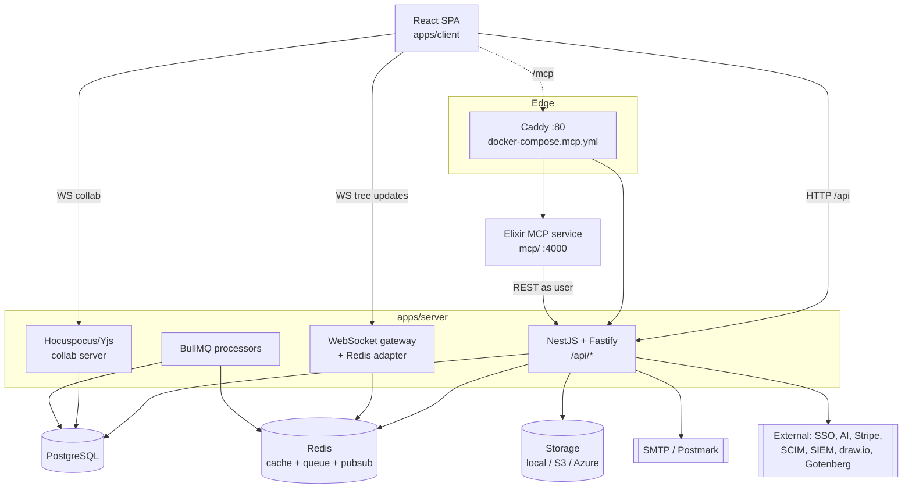

# Project Architecture — Docmost fork

## Overview

This repository is the **`noizu-forks/docmost` fork** of Docmost, an
open-source collaborative wiki / documentation platform. The architecture is
upstream Docmost's: a pnpm + Nx monorepo with a **NestJS/Fastify HTTP API**
(`apps/server`), a **React/Vite single-page client** (`apps/client`), and shared
**TypeScript packages** (`packages/editor-ext`, `packages/base-formula`).

Document editing is **multiplayer**: pages are TipTap/ProseMirror documents
backed by **Yjs CRDTs**, synchronised through a **Hocuspocus** collaboration
server over WebSocket. Persistence is **PostgreSQL** accessed through
**Kysely** (typed query builder + first-party migrations), with **Redis** for
caching, the BullMQ job queue, and the cross-instance WebSocket adapter.

The fork's only architectural addition is an **out-of-tree Elixir MCP service**
vendored in `mcp/` (a `git subtree` of `noizu-labs/docmost-mcp`) and fronted by
a Caddy edge defined in `docker-compose.mcp.yml`. It talks to the unchanged
Docmost REST API on behalf of the signed-in user. See `FORK.md`.

Component ↔ directory mapping: see [PROJ-LAYOUT.md](PROJ-LAYOUT.md).

## System Diagram

## Core Components

| Component | Purpose |
|-----------|---------|
| NestJS/Fastify API (`apps/server/src/core`, `main.ts`) | REST API under global prefix `api`; auth, pages, spaces, comments, shares, search, admin |
| Auth subsystem (`core/auth`, `strategies/jwt.strategy.ts`) | JWT (HS256, APP_SECRET) in `authToken` cookie or Bearer; access / API-key / OAuth token types |
| Authorization (`core/casl`) | CASL ability rules from workspace/space/page roles |
| Collaboration (`collaboration/`) | Hocuspocus server: Yjs sync, persistence, authentication extension |
| Realtime gateway (`ws/`) | Socket.IO-style WebSocket tree updates, Redis adapter, tree service |
| Persistence (`database/`) | Kysely migrations + repos over PostgreSQL |
| Integrations (`integrations/`) | storage, mail/transactional, redis, queue, encryption, export/import, audit, throttle, telemetry, security, environment |
| Community vs Enterprise (`community/`, `ee/`) | AGPL feature set; enterprise server code is the optional `apps/server/src/ee` submodule, loaded via guarded `require` |
| Shared packages (`packages/`) | `editor-ext` (TipTap extensions), `base-formula` (expression evaluator) |
| Client SPA (`apps/client/src`) | React/Vite UI; `features/`, `components/`, `ee/` (enterprise UI) |
| MCP service (`mcp/`) | Fork-local Elixir MCP server exposing Docmost to agents; session-identity auth |

## Data Flow

**Edit path.** The client opens a WebSocket to the collaboration server for a
page. Edits are CRDT operations merged by Hocuspocus, persisted as `ydoc`
(bytea) and flattened `content`/`text_content` on the `pages` row, and a
`tsvector` trigger keeps full-text search current. A separate WebSocket gateway
broadcasts tree/structure changes, fanned out across instances through Redis.

**Request path.** API requests carry the `authToken` cookie (or Bearer). The JWT
strategy validates signature + expiry against `APP_SECRET`, resolves the user
and workspace (and, for interactive sessions, an active `user_sessions` row),
then CASL guards authorise the action against the user's workspace/space/page
role. Background work (exports, imports, attachment indexing, emails, AI) runs
through BullMQ processors on Redis.

**MCP path (fork).** With `docker-compose.mcp.yml`, Caddy maps `{site}/mcp*`
to the Elixir service. The service verifies the `authToken` JWT locally with the
shared `DOCMOST_APP_SECRET`, rejects non-interactive token types, and forwards
the verified JWT as a Bearer token on Docmost REST calls — so every tool action
runs as the signed-in user under Docmost's own permission checks. Writes are
opt-in (`DOCMOST_MCP_WRITES=1`).

## Technology Stack

| Layer | Choice |
|-------|--------|
| API | NestJS 11 on Fastify 5; Passport JWT; CASL authorization |
| Persistence | PostgreSQL; Kysely query builder + migrations |
| Cache / queue / pubsub | Redis; BullMQ; Redis WebSocket adapter |
| Realtime docs | Hocuspocus 4 + Yjs; TipTap 3 / ProseMirror |
| Client | React, Vite, Mantine, TanStack Query/Table/Virtual, Excalidraw, draw.io |
| Storage | local, S3 (`@aws-sdk`), Azure Blob |
| Mail | SMTP (nodemailer) or Postmark; React Email templates |
| Integrations | OAuth2 server (`@jmondi/oauth2-server`), Stripe billing, AI SDK providers, SCIM, SIEM |
| MCP (fork) | Elixir/OTP service (`mcp/`), streamable HTTP |
| Build/tooling | pnpm 11, Nx 23, TypeScript, Docker multi-arch |

## Key Decisions

- **Additive fork integration.** All fork code lives in new paths (`mcp/`,
  `docker-compose.mcp.yml`, `FORK.md`); upstream files are untouched so upstream
  merges stay conflict-free. See `FORK.md`.
- **MCP as a separate service, not in-process.** The Elixir MCP server is a
  subtree, deployed behind a Caddy edge, and reuses Docmost's own auth/permissions
  by forwarding the user's session JWT rather than introducing a second auth model.
- **Kysely over an ORM.** First-party typed migrations keep the schema explicit;
  see [PROJ-SCHEMA.md](PROJ-SCHEMA.md).
- **CRDT persistence.** Yjs `ydoc` is authoritative for live editing; flattened
  text/JSON columns and the `tsvector` index serve search and export.

No component-level extraction was needed; this file stays within the size guide.
