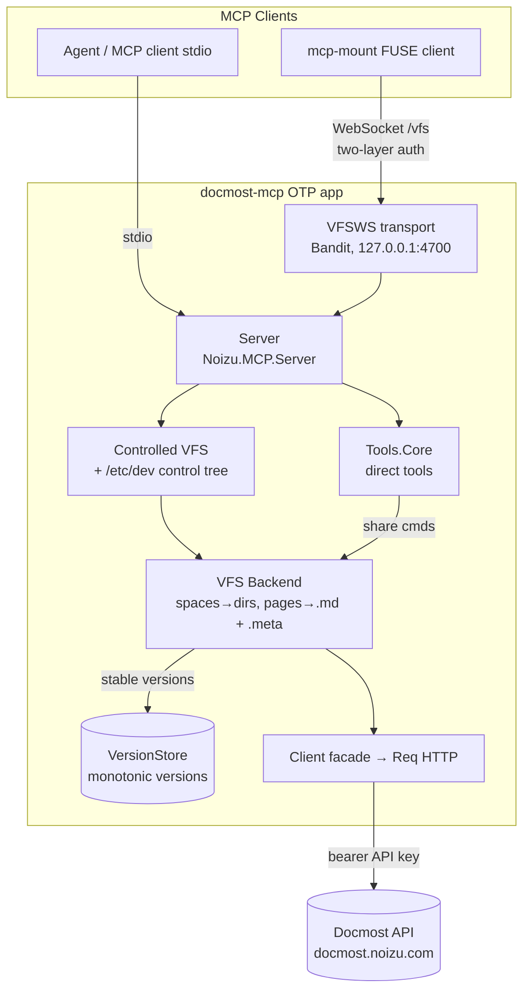

# Project Architecture

## Overview

`docmost-mcp` is an Elixir MCP server that exposes a Docmost wiki instance to MCP clients two ways: direct space/page/share tools, and a writable virtual filesystem where pages are `.md` files with `.meta` YAML control siblings. It is a stateless proxy over the Docmost HTTP API — no database of its own; the only state is an in-memory version counter. The default posture against the production Docmost instance is read-only; every mutation is gated by `DOCMOST_MCP_WRITES=1` (flippable at runtime via the `/etc/dev/config/writes` control file).

Built on the in-repo `noizu_mcp` library (sibling `elixir-mcp` checkout; `NOIZU_MCP_PATH` overrides outside the monorepo).

## System Diagram

## Core Components

| Component | Purpose |
|-----------|---------|
| `Server` | MCP server "docmost" v0.1.0; registers tools + VFS; stdio transport |
| `Tools.Core` | 7 direct tools (`docmost_*`) — list/get/create/update/delete/share |
| `VFS.Controlled` | VFS with `/etc/dev` control tree composed by delegation (introspection, `writes` toggle) |
| `VFS.Backend` | Real projection: space dirs, page `.md` + `.meta`, stat/read/write/remove/search/xattr |
| `PageFile` / `MetaFile` | Page = YAML frontmatter + Markdown; `.meta` = command YAML (writable vs read-only key sets) |
| `Client` + `Client.Req` | Docmost HTTP API facade behind `ClientBehaviour`; injectable stub for tests |
| `Mount` | Opt-in VFSWS WebSocket endpoint (Bandit, localhost-only) for `mcp-mount` FUSE projection |
| `VersionStore` | GenServer giving stable monotonic VFS versions; boot epoch + reset semantics force client re-pull after restart |
| `Config` / `Normalize` / `Error` | Runtime env, URL/response normalization, error types |

→ *Components ↔ directories: see [PROJ-LAYOUT.md](PROJ-LAYOUT.md). Data shapes: [PROJ-SCHEMA.md](PROJ-SCHEMA.md).*

## Data Flow

1. **Direct tools**: client → `Server` → `Tools.Core` → `Client` → Docmost API. Mutations check `Config.writes?` first.
2. **VFS read**: file op → `Controlled` (non-`/etc/dev` paths delegate) → `Backend` → fetch page/space → `PageFile`/`MetaFile` encode → versioned via `VersionStore`.
3. **VFS write**: decoded content/meta → writes gate → API mutation (`operation: replace` for content) → fresh read-back returns canonical YAML.
4. **Mount**: `mcp-mount` → VFSWS (Bearer on HTTP upgrade, then `vfs/auth` frame) → same VFS path. External Docmost edits are invisible until reconnect/re-sync.

## Key Decisions

- **Opt-in writes**: default read-only against the production instance; gate is env + runtime toggle.
- **`.meta` as command file, not round-trip doc**: read output contains protected/effective fields that are rejected on write-back; minimal command YAML is the contract.
- **Inherited shares immutable at children**: reported via positive `*_level`; must be changed at the ancestor (`eacces` error).
- **Permissions replace = closest-to-transactional**: validate-then-add-before-remove leaves a safe superset on mid-request failure.
- **Localhost-only mount listener, separate token**: mount token authorizes the WebSocket only, carries no Docmost credentials.
- **Ephemeral versions by design**: nothing persists; restart/reset bumps the epoch so clients re-pull rather than trust stale trees.

## Technology Stack

Elixir 1.18 (OTP 28) · `noizu_mcp` (sibling `elixir-mcp`) · Req (HTTP) · Bandit + Plug (WebSocket) · Jason · yaml_elixir · CI via GitHub Actions (format check, `--warnings-as-errors`, `mix test`, coverage threshold 90% (mix.exs test_coverage, enforced via `mix test --cover`)).
