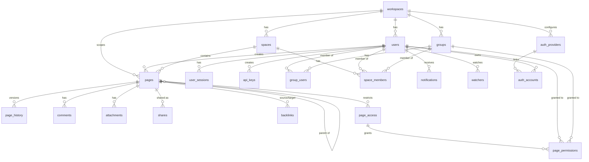
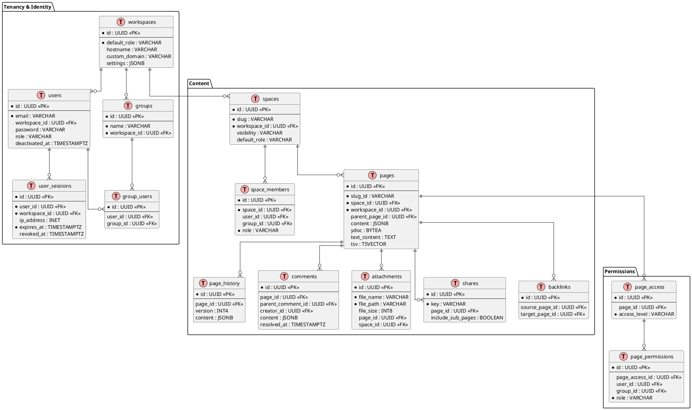

# Project Schema — Docmost fork

Persistence and structured-data reference. Docmost is **PostgreSQL-backed**;
the schema is created and evolved by **Kysely migrations** in
`apps/server/src/database/migrations/` (52 ordered `*.ts` files, run via
`apps/server/src/database/migrate.ts`). There is no separate Liquibase layer —
Kysely's migrator is the source of truth. Code organization for schema sources:
see [PROJ-LAYOUT.md](PROJ-LAYOUT.md) (`apps/server/src/database/`).

Conventions actually used in this schema:

- Primary keys: `uuid` with `DEFAULT gen_uuid_v7()` (a `gen_uuid_v7()` SQL
  function installed by `20240324T085400-uuid_v7_fn.ts`).
- Timestamps: `timestamptz` (with time zone) with `DEFAULT now()`, managed in
  UTC by application code. The modification column is `updated_at`; many tables
  also carry soft-delete `deleted_at`.
- Every tenant-scoped row carries `workspace_id` (FK → `workspaces`, cascade).
- Enum-like values are stored as `varchar` with TypeScript enums
  (`apps/server/src/common/helpers/types/permission.ts`); the only native PG
  enum type is `auth_provider_type`.

## Entity-Relationship Diagram (core domains)

## Core tables

### workspaces

Top-level tenant. | Column | Type | Null | Default |
|---|---|---|---|
| id | uuid | no | gen_uuid_v7() |
| name | varchar | yes | — |
| description | varchar | yes | — |
| logo | varchar | yes | — |
| hostname | varchar | yes | — |
| custom_domain | varchar | yes | — |
| settings | jsonb | yes | — |
| default_role | varchar | no | `member` |
| email_domains | varchar[] | yes | `{}` |
| default_space_id | uuid | yes | — |
| created_at / updated_at / deleted_at | timestamptz | mixed | now() / — |

Constraints: `workspaces_hostname_unique`, `workspaces_custom_domain_unique`.

### users

Workspace member. | Column | Type | Null | Default |
|---|---|---|---|
| id | uuid | no | gen_uuid_v7() |
| name | varchar | yes | — |
| email | varchar | no | — |
| email_verified_at | timestamptz | yes | — |
| password | varchar | yes | — (bcrypt hash) |
| avatar_url | varchar | yes | — |
| role | varchar | yes | — (`owner`/`admin`/`member`) |
| invited_by_id | uuid | yes | — |
| workspace_id | uuid | yes | — |
| locale / timezone | varchar | yes | — |
| settings | jsonb | yes | — |
| last_active_at / last_login_at | timestamptz | yes | — |
| deactivated_at | timestamptz | yes | — |
| created_at / updated_at / deleted_at | timestamptz | mixed | now() / — |

Constraints: `users_email_workspace_id_unique (email, workspace_id)`.

### spaces / space_members

`spaces`: `id`, `name`, `description` (text), `slug` (not null), `logo`,
`visibility` (default `private`), `default_role` (default `writer`),
`creator_id`, `workspace_id` (not null), timestamps. Unique
`spaces_slug_workspace_id_unique`.

`space_members`: `id`, `user_id`, `group_id`, `space_id` (not null), `role`
(not null), `added_by_id`, timestamps. A member row is **either** a user
**or** a group (`allow_either_user_id_or_group_id_check`); unique per
`(space_id,user_id)` and `(space_id,group_id)`.

### pages

The document node. | Column | Type | Null |
|---|---|---|
| id | uuid | no |
| slug_id | varchar | no |
| title | varchar | yes |
| icon | varchar | yes |
| cover_photo | varchar | yes |
| position | varchar | yes (fractional index) |
| content | jsonb | yes |
| ydoc | bytea | yes (Yjs CRDT state) |
| text_content | text | yes (flattened text for search) |
| tsv | tsvector | yes (GIN index `pages_tsv_idx`) |
| parent_page_id | uuid → pages.id (cascade) | yes |
| creator_id / last_updated_by_id / deleted_by_id | uuid → users.id | yes |
| space_id | uuid → spaces.id (cascade) | no |
| workspace_id | uuid → workspaces.id (cascade) | no |
| is_locked | boolean | no (default false) |
| created_at / updated_at / deleted_at | timestamptz | mixed |

Constraints: `pages_slug_id_unique`. Search: `pages_tsv_idx` (GIN, maintained
by the tsvector trigger from `20240324T086800-pages-tsvector-trigger.ts`,
later updated for unaccented `pg_trgm`); `pages_slug_id_idx`.

### page_history

Per-version snapshot: `id`, `page_id` (FK), `slug_id`, `title`, `content`
(jsonb), `slug`, `icon`, `cover_photo`, `version` (int4), `last_updated_by_id`,
`space_id`, `workspace_id`, timestamps. (`contributor_ids` added later.)

### comments

`id`, `content` (jsonb), `selection` (varchar), `type` (varchar), `creator_id`,
`page_id` (FK), `parent_comment_id` (self FK), `workspace_id`, `resolved_at`,
`created_at`, `edited_at`, `deleted_at`. Newer columns added for comment
resolution / viewer comments.

### attachments

`id`, `file_name` (not null), `file_path` (not null), `file_size` (int8),
`file_ext` (not null), `mime_type`, `type`, `creator_id`, `page_id`, `space_id`,
`workspace_id`, timestamps. Indexed content for `ATTACHMENT_INDEXING` added
later.

### shares

Public page shares: `id`, `key` (not null), `page_id` (FK),
`include_sub_pages` (bool default false), `search_indexing` (bool default
false), `creator_id`, `space_id`, `workspace_id`, timestamps. Unique
`shares_key_workspace_id_unique`.

### backlinks

`id`, `source_page_id` (FK), `target_page_id` (FK), `workspace_id`, timestamps.
Unique `backlinks_source_page_id_target_page_id_unique`.

### page_access / page_permissions

`page_access`: `id`, `page_id` (FK), `workspace_id`, `space_id`,
`access_level` (not null, e.g. `restricted`), `creator_id`, timestamps.
`page_permissions`: `id`, `page_access_id` (FK), `user_id` or `group_id`,
`role` (not null, `reader`/`writer`), `added_by_id`, timestamps; unique per
`page_access_user_unique` / `page_access_group_unique`; indexes
`idx_page_access_space`, `idx_page_permissions_user`,
`idx_page_permissions_group`.

### notifications / watchers

`notifications`: `id`, `user_id`, `workspace_id`, `type` (text not null),
`actor_id`, `page_id`, `space_id`, `comment_id`, `data` (jsonb), `read_at`,
`emailed_at`, `archived_at`, `created_at`; indexes `idx_notifications_user_id`,
`idx_notifications_user_unread`.
`watchers`: `id`, `user_id`, `page_id`, `space_id`, `workspace_id`, `type`
(text not null), `added_by_id`, `muted_at`, `created_at`; indexes
`idx_watchers_user_page`, `idx_watchers_user_space`, `idx_watchers_page_id`.

### user_sessions

Interactive session records: `id`, `user_id` (FK), `workspace_id` (FK),
`device_name`, `user_agent` (text), `ip_address` (inet), `geo_location`,
`last_active_at`, `expires_at` (not null), `metadata` (jsonb), `revoked_at`,
`created_at`.

### api_keys

`id`, `name` (text), `creator_id`, `workspace_id`, `expires_at`,
`last_used_at`, `created_at`, `updated_at`, `deleted_at`.

## Enum-like value domains

| Domain | Values | Where defined |
|---|---|---|
| `UserRole` | owner, admin, member | `common/helpers/types/permission.ts` |
| `SpaceRole` | admin, writer, reader | same |
| `SpaceVisibility` | open, private | same |
| `PageAccessLevel` | restricted | same |
| `PagePermissionRole` | reader, writer | same |
| `UserTokenType` | forgot-password, email-verification | `core/auth/auth.constants.ts` |
| `JwtType` | access, api_key, oauth_access (collab/other tokens rejected by strategy) | `core/auth/dto/jwt-payload` |
| `auth_provider_type` (native PG enum) | provider kinds | migration `20250118T194658-sso-auth.ts` |

## Other tables (not detailed here)

`auth_providers` (`id,name,type,saml_url,saml_certificate,oidc_issuer,
oidc_client_id,oidc_client_secret,allow_signup,is_enabled,creator_id,
workspace_id,…`), `auth_accounts`, `user_tokens`, `user_mfa`, `billing`,
`favorites`, `labels`, `page_labels`, `file_tasks`, `public_spaces`,
`templates`, `audit`, `siem_destinations`, `scim_tokens`, `ai_chats`,
`ai_chat_messages`, `oauth_clients`, `oauth_tokens`, `oauth_grants`,
`oauth_authorization_codes`, `page_transclusions`,
`page_transclusion_references`, `page_verifications`, `page_verifiers`,
`base_properties`, `base_rows`, `base_views`. Column details live in their
migration files.

## Migration history summary

52 migrations from `20240324` (initial: workspaces, users, groups, spaces,
workspace_invitations, pages, page_history, comments, attachments, tsvector
trigger) through `2026-04` (ai-chat, templates). Later changes are additive
`alterTable` edits plus index/constraint additions — notably workspaces (21
alters: billing, license, SSO, settings), pages (contributor ids, permissions),
comments (resolution/viewer), and auth_providers (group sync, LDAP). No
destructive column drops are present in the recorded history.

## Non-relational structured data

### Configuration (environment)

Loaded via `apps/server/src/integrations/environment/environment.service.ts`
from env vars (documented template in `.env.example`):

| Key | Shape / meaning |
|---|---|
| `APP_URL`, `PORT` | Public URL; HTTP port (default 3000) |
| `APP_SECRET` | ≥32-char HS256 signing key for session/API JWT (also `DOCMOST_APP_SECRET` for MCP) |
| `JWT_TOKEN_EXPIRES_IN` | JWT TTL (default 30d) |
| `DATABASE_URL` | Postgres DSN |
| `REDIS_URL` | Redis DSN |
| `STORAGE_DRIVER` | `local` \| `s3` \| `azure` + driver creds (`AWS_S3_*`, `AZURE_*`) |
| `FILE_UPLOAD_SIZE_LIMIT` | bytes (default 50mb) |
| `MAIL_DRIVER` | `smtp` \| `postmark` + creds |
| `DRAWIO_URL`, `GOTENBERG_URL` | External draw.io / PDF-export services |
| `DISABLE_TELEMETRY`, `DEBUG_MODE`, `DEBUG_DB`, `LOG_HTTP` | Ops toggles |
| `IFRAME_EMBED_ALLOWED`, `IFRAME_ALLOWED_ORIGINS` | Frame-embedding policy |

### Storage layout

Attachments/avatars are stored via the storage driver (local filesystem under
`data/storage` in the compose volume, or S3/Azure). The DB row
(`attachments.file_path`) records the object key/path; `file_size` (int8) and
`file_ext`/`mime_type` describe the blob. No relational data lives in the blob
store.

### Redis / queue

Redis is used for caching, the cross-instance WebSocket adapter, and BullMQ.
Queues are named with hash-tag keys (`integrations/queue/constants`): e.g.
`{email-queue}`, `{attachment-queue}`, `{general-queue}`, `{billing-queue}`,
`{file-task-queue}`, `{search-queue}`, `{ai-queue}`, `{history-queue}`,
`{notification-queue}`, `{audit-queue}`, `{base-queue}`, `{siem-queue}`. Jobs
are pure work descriptors (e.g. `send-email`, `export-task`, `import-task`,
`search-index-page`); state is not authoritative — Postgres is.

### API / MCP interface

HTTP contract: REST under global prefix `api`, JWT in `authToken` cookie or
`Authorization: Bearer`. Request/response shapes are defined by DTOs under each
module's `dto/` directory. The fork MCP service (`mcp/`) exposes a separate
contract — Docmost REST proxied as MCP tools plus a page VFS (`.md` files with
YAML frontmatter) — documented in `mcp/docs/PROJ-SCHEMA.md`.
