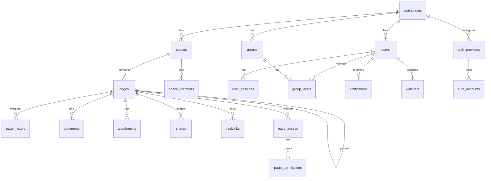

# Project Schema — summary

Docmost is **PostgreSQL-backed**; the schema is defined by **Kysely migrations**
(52 files in `apps/server/src/database/migrations/`) — no Liquibase. Conventions:
`uuid` PKs `DEFAULT gen_uuid_v7()`, `timestamptz` with `now()` defaults, tenant
rows carry `workspace_id`, soft-delete `deleted_at`, modification column
`updated_at`. Enum-like values are `varchar` + TS enums; only `auth_provider_type`
is a native PG enum.

**Principal tables:** `workspaces`, `users`, `spaces`, `space_members`,
`pages` (jsonb `content`, bytea `ydoc`, `text_content`, GIN `tsv` index,
self-ref `parent_page_id`), `page_history`, `comments`, `attachments`,
`shares`, `backlinks`, `groups`/`group_users`, `page_access`/`page_permissions`,
`notifications`, `watchers`, `user_sessions`, `api_keys`.

**Remaining tables:** auth_providers/auth_accounts, user_tokens, user_mfa,
billing, favorites, labels/page_labels, file_tasks, public_spaces, templates,
audit, siem_destinations, scim_tokens, ai_chats/ai_chat_messages, oauth_*,
page_transclusion*, page_verification*, base_properties/rows/views.

**Non-relational data:** env config (`.env.example` → `EnvironmentService`),
storage layout (local/S3/Azure blobs referenced by `attachments.file_path`),
Redis + BullMQ queues (`{email-queue}`, `{search-queue}`, …, job names only —
Postgres is authoritative), and the REST/MCP interface contracts.

Full detail (ERDs, per-table columns, indexes): [PROJ-SCHEMA.md](PROJ-SCHEMA.md)
