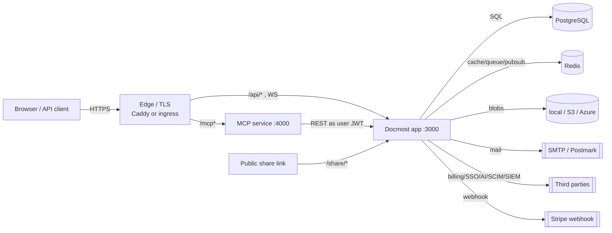

# Threat Model — Docmost fork

## Overview

Docmost is a **multi-tenant collaborative wiki**: one deployment can host many
workspaces, each with users, spaces, and page hierarchies. Crown jewels are
**page content** (including private/restricted pages), **user credentials and
sessions**, **attachment blobs**, and the **workspace isolation boundary**. The
system is exposed to the public internet and holds a large authenticated-user
surface (REST API, realtime WebSocket, file upload/download, public share links).

This model is grounded in the code in this checkout and in the deployed shape
described by `Dockerfile`, `docker-compose.yml`, `docker-compose.mcp.yml`, and
`.env.example`. Where a control lives in the optional Enterprise submodule
(`apps/server/src/ee`, not present when uninitialised), it is marked as such
rather than assumed. Component/directory grounding: [PROJ-ARCH.md](PROJ-ARCH.md),
[PROJ-LAYOUT.md](PROJ-LAYOUT.md).

The fork adds one boundary: the **Elixir MCP service** (`mcp/`) behind a Caddy
edge, which verifies Docmost session JWTs with the shared `APP_SECRET` and
forwards them to Docmost REST as the signed-in user.

## Trust boundaries

1. **Internet ↔ edge.** Caddy/ingress terminates TLS; `/mcp*` → MCP service,
   everything else → Docmost app. Static/HTML responses carry frame-embedding
   headers (CSP `frame-ancestors` behaviour in `main.ts`).
2. **Edge ↔ app process.** Docmost API (NestJS/Fastify) trusts a workspace
   context resolved from the request host + JWT.
3. **App ↔ data stores.** Postgres, Redis, and the blob store (local/S3/Azure)
   are reachable only from the app with credentials from env.
4. **App ↔ third parties (egress).** SMTP/Postmark, S3/Azure, Stripe (billing),
   AI providers, SSO providers (SAML/OIDC), SCIM clients, SIEM sinks, draw.io,
   Gotenberg.
5. **Tenant isolation.** Every tenant-scoped row carries `workspace_id`; the JWT
   strategy rejects a request whose resolved workspace ≠ token workspace.
6. **MCP edge ↔ MCP service ↔ Docmost.** The MCP service authenticates the
   session JWT itself and re-presents it to Docmost.

## Attack surface

**Ingress enumerated:** REST under `/api/*`; WebSocket gateway (`ws/`) and
collaboration (`/collab`); file upload/download (`/api/files/*`); public share
pages (`/share/:shareId/p/:pageSlug`) and public space pages (`/docs/*`); auth
endpoints (`/api/auth/*`, SSO callbacks); OAuth2 endpoints (`.well-known/*`,
`/mcp` native + fork MCP); SCIM (`application/scim+json` parser); billing
webhook (`/api/billing/stripe/webhook`); `/api/health`, `/api/version`.
Unauthenticated (excluded from the workspaceId requirement in `main.ts`):
`auth/setup`, `health`, `billing/stripe/webhook`, `workspace/check-hostname`,
`sso/google`, `workspace/create`, `workspace/joined`, `workspace/find-by-email`.

## Vulnerability register

| ID | Severity | STRIDE | Component | Status |
|----|----------|--------|-----------|--------|
| T-001 | High | Spoofing | Session JWT HS256 signed with single `APP_SECRET`; shipped compose example uses `REPLACE_WITH_LONG_SECRET` | Mitigated-by-config (deploy must set a strong ≥32-char secret) |
| T-002 | Medium | Elevation | Global `api` guard requires a workspace context; JWT strategy rejects token/workspace mismatch and disabled users | Mitigated (`jwt.strategy.ts`) |
| T-003 | Medium | Elevation | Interactive-only semantics: non-`access` token types (collab/exchange/attachment/pdf/mfa) must not reach general API | Mitigated (strategy accepts only access/api_key/oauth_access) |
| T-004 | Medium | Info disclosure | Attachment inline serving; `.svg` is served inline | Partial (extension allowlist + sanitized filename; SVG inline is an XSS vector by nature) |
| T-005 | Medium | Spoofing/DoS | Auth, OAuth register/token/authorize, AI chat, SIEM-test are rate-limited; other routes are not | Partial (named throttlers only, Redis-backed) |
| T-006 | Medium | Info disclosure | Iframe embedding disabled by default; OAuth consent screen force-denied even without the global header | Mitigated (`resolveFrameHeader(s)ForPath`) |
| T-007 | Medium | Tampering/Spoofing | Stripe billing webhook is unauthenticated at the router; signature verification, if any, lives in the enterprise billing module | Open / verify in `ee` (not present here) |
| T-008 | High | Elevation | MCP service verifies session JWT with shared secret and acts as the user; page create/update/delete/share gated by `DOCMOST_MCP_WRITES` | Mitigated by default (read-only); write posture opt-in |
| T-009 | Medium | Spoofing | MCP static shared key (`DOCMOST_API_KEY`) honoured only when `DOCMOST_MCP_ALLOW_STATIC_KEY=1`; a presented-but-invalid session never falls back to it | Mitigated (`FORK.md`, compose override) |
| T-010 | Medium | Info disclosure | AI features send page content to third-party AI providers (egress); AI controls feature-gated | Partial (feature-gated; depends on config) |
| T-011 | Medium | Info disclosure | Storage credentials (S3/Azure) and DB/Redis DSNs via env; local driver writes under `data/storage` | Mitigated-by-config (secrets not in repo; `.env*` gitignored) |
| T-012 | Low | Repudiation | Audit log + SIEM export exist but are feature-gated (enterprise) | Partial |
| T-013 | Medium | DoS | Upload size bounded (`FILE_UPLOAD_SIZE_LIMIT`, default 50mb); no global body-rate limit beyond named throttlers | Partial |
| T-014 | Low | Tampering | Supply chain: pnpm lockfile + `patches/`; compose default pulls floating `docmost/docmost:latest` | Partial (pin images in production; release workflow builds tagged `v*` images) |
| T-015 | Low | Info disclosure | Passwords stored as bcrypt hashes; sensitive stored values can be encrypted with AES-256-GCM derived from `APP_SECRET` (`integrations/encryption`) | Mitigated (bcrypt; encryption helper present) |

## Mitigation coverage

2 mitigated-by-config · 4 mitigated · 7 partial · 1 open/verify (T-007) ·
1 opt-in (T-008/T-009). The only entry requiring verification outside this
checkout is T-007 (Stripe signature handling in the enterprise billing module).
No Critical entry is open in the AGPL code present here.

→ Section detail is intentionally kept inline here; extract to `threats/*.md`
when a section outgrows this file (keep vulnerability IDs stable).

## Residual risk

- **Single shared secret.** `APP_SECRET` signs session JWTs *and* derives the
  encryption key *and* is handed to the MCP service. Rotation invalidates all
  sessions and encrypted values at once; accepted for a self-hosted deployment
  where one operator controls the secret store. Mitigation: keep it in the
  secret manager, never in the repo.
- **Enterprise-only controls are opaque here.** Billing/Stripe, SCIM, SIEM
  delivery, and API-key/OAuth validation have AGPL fallbacks in the JWT strategy
  but their full implementations live in `apps/server/src/ee` (submodule). This
  model does not assert their internals.
- **SVG/inline attachment XSS** is accepted as a product trade-off; operators
  exposing attachments to untrusted users should restrict upload types.
- **MCP writes** are opt-in; the default read-only posture against the production
  instance is the accepted baseline.
