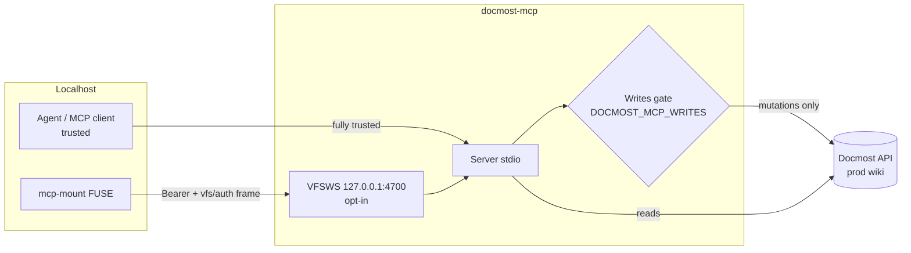

# Threat Model

## Overview

`docmost-mcp` brokers access to the **production Noizu Docmost wiki** (default `DOCMOST_API_URL`) — the crown jewels are the wiki's content and its sharing/permission state. Two entry points: an MCP stdio server (client is the local agent harness, fully trusted) and an opt-in localhost WebSocket for `mcp-mount` (authenticated by a separate mount token). One egress: the Docmost API over HTTPS with a bearer API key. There is no database, no persistence, and no other listener.

Trust boundaries: (1) mount client ↔ VFSWS listener (localhost, token-gated); (2) server ↔ Docmost API (API key); (3) wiki content ↔ agent context (VFS output is consumed by an LLM). Grounding: [PROJ-ARCH.md](PROJ-ARCH.md) · [PROJ-LAYOUT.md](PROJ-LAYOUT.md).

## Attack Surface

Entry points: MCP stdio tools (7), VFS ops incl. `.meta` command files and `/etc/dev/**` control files, VFSWS `GET /vfs`. Stores: none local; remote wiki. Egress: Docmost API (HTTPS + bearer). No webhooks, cron, or queues.

## Vulnerability Register

| ID | Severity | STRIDE | Component | Status |
|----|----------|--------|-----------|--------|
| T-001 | High | Tampering / Elevation | Mutations against production wiki | Mitigated — writes gate (`DOCMOST_MCP_WRITES`, default off; checked in `Tools.Core.write/1` and `MetaFile.apply/2`) |
| T-002 | High | Elevation | Mount client flips writes on at runtime | Partial — `/etc/dev/config/writes` toggle requires mount token; token holder is trusted operator; localhost-only listener limits remote reach |
| T-003 | Medium | Spoofing | Mount token compromise → wiki read/write via VFS | Mitigated — two-layer auth (Bearer on HTTP upgrade 401-before-socket, then `vfs/auth` frame, `-32001` on mismatch); listener binds 127.0.0.1 only; token is separate from `DOCMOST_API_KEY` and grants no HTTP credentials |
| T-004 | Medium | Info disclosure / Tampering | Wiki content is attacker-influenceable and LLM-consumed (prompt injection via page Markdown/meta read through VFS) | Open — accepted: content is from the operator's own wiki; treat VFS reads as untrusted data in agent prompts |
| T-005 | Medium | Tampering | Path traversal / malformed paths in VFS ops | Mitigated — `VFS.Path.parse/1` rejects `.`/`..` and segments outside `[A-Za-z0-9._-]`; conformance + path tests |
| T-006 | Low | Tampering | Malformed/unknown `.meta` YAML commands | Mitigated — strict key allowlist (writable vs read-only sets), unknown keys rejected, UUID shape validation, unknown YAML rejected |
| T-007 | Medium | Tampering | Permission replace mid-request failure leaves superset | Mitigated-by-design — validate-then-add-before-remove yields a safe (never under-permissioned) intermediate state |
| T-008 | Medium | Repudiation | No local audit trail of VFS/tool mutations | Open — Docmost-side audit only; ephemeral `VersionStore` keeps no history (by design) |
| T-009 | Medium | Info disclosure | `DOCMOST_API_KEY` / mount token in env | Mitigated — `.env.example` warnings; secret-management workflow; tokens never logged or echoed in responses |
| T-010 | Low | DoS | VFSWS listener / stdio flooding | Mitigated — localhost-only, opt-in listener; no public exposure |
| T-011 | Low | Elevation | Inherited-share removal at child pages | Mitigated — rejected with `eacces`; must be changed at the ancestor |

## Mitigation Coverage

8 mitigated · 1 partial (T-002) · 2 open (T-004, T-008). Open items: T-004 is an accepted content-trust boundary (agent-side hygiene, documented in README); T-008 accepted for a stateless proxy — Docmost is the audit system of record.

## Residual Risk

- A mount-token holder operating on the same machine can enable writes and mutate the production wiki (T-002/T-004 combination) — accepted because the mount is an operator surface, localhost-only, and opt-in.
- Default API URL is production: a developer enabling writes without pinning `DOCMOST_API_URL` mutates the real wiki. README carries an explicit safety warning; risk accepted with that guardrail.
- `.meta` replace-mode is atomic-ish, not transactional (T-007 residual: a superset, never a subset).

## Supply Chain

Deps pinned in `mix.lock`: `req`, `bandit`, `plug`, `jason`, `yaml_elixir`, plus the sibling `elixir-mcp` path dep (`noizu_mcp`) — inside the monorepo trust boundary; `NOIZU_MCP_PATH` override outside the monorepo points at a developer-controlled checkout. CI runs `mix compile --warnings-as-errors` + tests; no post-install scripts.
